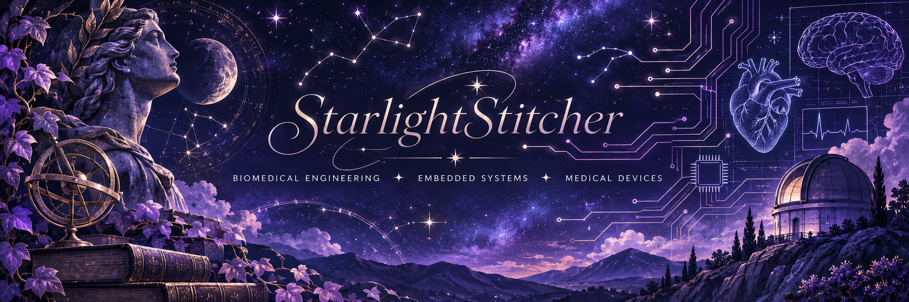

  

 
✦ Hello, I'm Regina! 🌙

### Biomedical Engineering Student | Embedded Systems | Medical Devices

*Exploring the space between human health, electronics, and engineering.*

I'm a Biomedical Engineering student at **Virginia Commonwealth University**, pursuing a minor in Electrical Engineering, with an expected graduation of **May 2027**.

I'm fascinated by the intersection of hardware, software, and healthcare—especially embedded systems, biomedical instrumentation, sensors, and medical-device development.

I enjoy taking an idea from a concept to a working system, figuring out why something doesn't work along the way, and learning something new with every iteration.

---

## ✧ Areas of Interest

- Embedded systems and firmware development
- Biomedical instrumentation and medical devices
- Electronics and circuit design
- Sensor integration and physiological signal processing
- Wireless communication and data acquisition
- Hardware development and PCB design

## ☾ Technologies & Tools

| Category | Tools & Technologies |
|---|---|
| Programming | Python, MicroPython, MATLAB, Arduino C |
| Embedded Systems | Raspberry Pi Pico 2 W, Arduino, I²C, BLE, nRF24L01+ |
| Engineering Software | Ansys HFSS, MATLAB/Simulink, SolidWorks |
| Laboratory | Oscilloscopes, multimeters, waveform generators, power supplies |
| Fabrication | Soldering, 3D printing, laser cutting |

## ✦ Featured Projects

### 🌙 SELENE — Wearable Multi-Sensor Health Monitoring System

A wearable health-monitoring system developed using a Raspberry Pi Pico 2 W and multiple physiological sensors. Named after the Greek goddess and personification of the Moon, SELENE represents the continuous observation of physiological signals and rhythms.

**Technologies:** MicroPython · Raspberry Pi Pico 2 W · I²C · BLE · MAX30102 · MAX30205 · VEML7700

### 🪽 HERMES — Wireless Biometric Data Transmission System

A wireless biometric-data acquisition system integrating physiological sensors, an Arduino, an nRF24L01+ transceiver, and a fabricated microstrip patch antenna. Inspired by Hermes, the messenger of the Greek gods, this project explores wireless communication and physiological data transmission.

**Technologies:** Arduino · nRF24L01+ · Wireless Communication · RF · MATLAB · Ansys HFSS

### ✨ ORION — Antenna Design & Electromagnetic Modeling

A collection of antenna design projects involving analytical calculations, electromagnetic simulation, fabrication, and experimental testing. Named after the constellation Orion, this project represents the exploration of electromagnetic structures and wireless communication.

**Technologies:** Ansys HFSS · MATLAB · Microstrip Patch Antennas · RF Testing

### ☀️ HELIOS — RF Hyperthermia & Biological-Tissue Modeling

An electromagnetic modeling and experimental research project exploring RF hyperthermia applications. Includes antenna-array design, biological-tissue modeling, specific absorption rate (SAR) analysis, and experimental RF heating.

**Technologies:** Ansys HFSS · MATLAB · RF Engineering · Electromagnetic Simulation · SAR Analysis

### 💊 MedTrack — Smart Medication Adherence Device

A medical-device concept designed to track medication access and support adherence through sensor-based detection and reminders. Developed with consideration for usability, accessibility, privacy, and patient needs.

**Technologies:** Sensor Integration · Embedded Systems · Medical-Device Design

---

## 🌱 Currently Exploring

- PCB design and electronic hardware development
- Embedded firmware and microcontroller applications
- Hardware debugging and system integration
- Building personal engineering projects

## ✧ A Little More About Me

Outside of engineering, I enjoy astronomy, Greek mythology, crafting, and anything that lets me create something with my hands.

I believe engineering and creativity belong together. There's always something new to discover.

---

### ☄️ Let's Connect

[LinkedIn](https://www.linkedin.com/in/regina-velazquez)

*Thanks for stopping by. Stay curious, keep creating, and reach for the stars.* ✨

<!--
**StarlightStitcher/StarlightStitcher** is a ✨ _special_ ✨ repository because its `README.md` (this file) appears on your GitHub profile.

Here are some ideas to get you started:

- 🔭 I’m currently working on ...
- 🌱 I’m currently learning ...
- 👯 I’m looking to collaborate on ...
- 🤔 I’m looking for help with ...
- 💬 Ask me about ...
- 📫 How to reach me: ...
- 😄 Pronouns: ...
- ⚡ Fun fact: ...
-->
